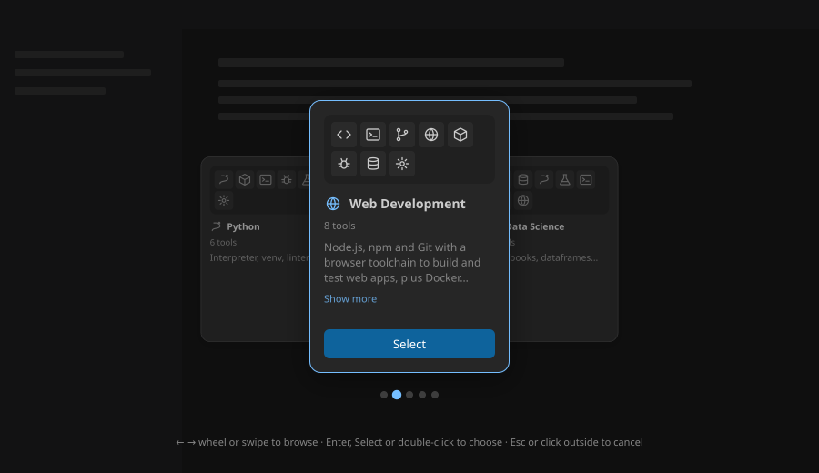

# Carousel

<!-- Component overview for the three-card carousel selector -->
<!-- Explains usage, props, interaction and theming -->

A **modal picker** that shows one item at a time as a focused card, with its two
neighbours fanned out behind it. The user browses the items and confirms one or dismisses
the picker; it fits choices that read better as cards than as a list, such as a profile or
a tool set. It came from Pilot, the `portunix-vscode` desktop app.

The carousel holds no selection of its own: it opens on `activeId` and reports the result
through `onSelect` or `onCancel`, and the host unmounts it afterwards.



## Usage

```tsx
import { Carousel, type CarouselItem } from '@cassandragargoyle/react-components/carousel';

const items: CarouselItem[] = [
    { id: 'python', label: 'Python', meta: '6 tools', description: 'Interpreter, venv, linters' },
    { id: 'web', label: 'Web Development', icon: <GlobeIcon />, meta: '8 tools', description: '…' },
    { id: 'data', label: 'Data Science', meta: '7 tools', description: '…' },
];

{open && (
    <Carousel
        items={items}
        activeId={profileId}
        onSelect={(id) => { setProfileId(id); setOpen(false); }}
        onCancel={() => setOpen(false)}
    />
)}
```

## Props

| Prop | Type | Default | Description |
| ---- | ---- | ------- | ----------- |
| `items` | `CarouselItem[]` | — | Items to browse; nothing renders when empty |
| `activeId` | `string` | — | Item focused on open; the first when no item matches |
| `onSelect` | `(id: string) => void` | — | Called with the focused item's id on confirmation |
| `onCancel` | `() => void` | — | Called when the picker is dismissed |
| `selectLabel` | `string` | `'Select'` | Text of the confirm button |

`CarouselItem`:

| Field | Type | Description |
| ----- | ---- | ----------- |
| `id` | `string` | Unique item id |
| `label` | `string` | Card title, also the slide's `aria-label` |
| `description` | `string` | Three lines on the focused card, with *Show more* past 80 characters; one line on a neighbour |
| `icon` | `ReactNode` | Monochrome icon before the label |
| `meta` | `string` | Secondary line under the label, such as a count |
| `preview` | `ReactNode` | Content at the top of the card, such as a grid of `.carousel-tool-icon` tiles |
| `accentColor` | `string` | Border colour of the focused card |

## Behavior

- **Browse** — `←`/`→`, the mouse wheel, a horizontal swipe of more than 40px, a click on
  a neighbour card or a pagination dot. Navigation wraps around and is ignored while the
  300ms card animation runs.
- **Confirm** — `Enter`, the *Select* button or a double-click on the focused card. The
  overlay fades out first and `onSelect` follows 200ms later.
- **Cancel** — `Escape` or a click on the backdrop, again after the 200ms fade.
- **Accessibility** — the overlay is a modal `role="dialog"`; the track takes focus on
  open and carries `aria-roledescription="carousel"`, each card is a `slide` group and the
  dots are a `tablist` labelled by the item labels.
- With one item there are no neighbours and no dots.

## Styling

Styles are scoped to `.carousel-*` classes. The overlay is fixed over the viewport at
`z-index: 200`. Colours read the VS Code theme variables (`--vscode-editorWidget-background`,
`--vscode-sideBar-border`, `--vscode-button-*`, `--vscode-foreground`) and the Pilot
variables `--pilot-link`, `--pilot-dim`, `--pilot-fg` and `--pilot-btn-bg`, with dark-theme
fallbacks for all of them.

## Files

- `Carousel.tsx` — the component and its props
- `Carousel.css` — scoped stylesheet
- `Carousel.svg` — visual reference (this README's image)
- `index.ts` — public exports
