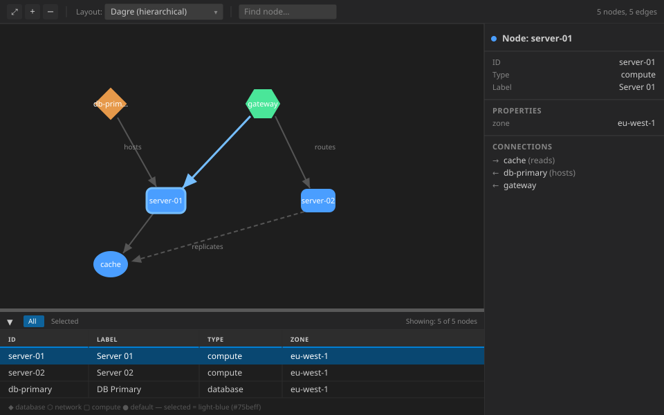
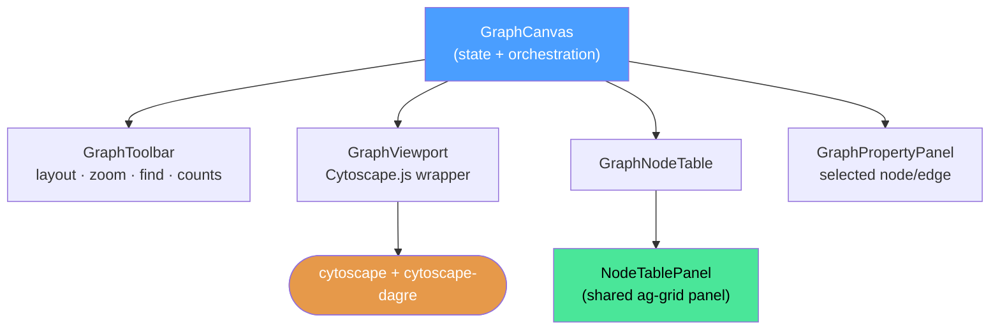
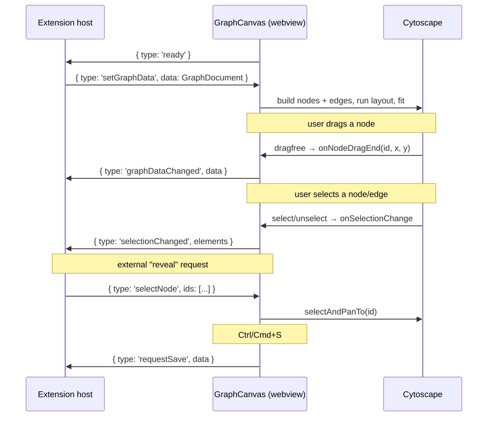
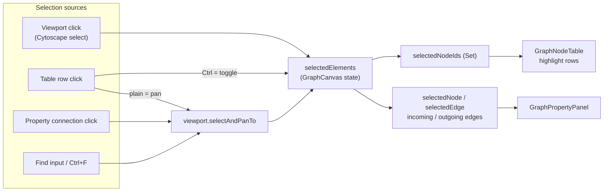
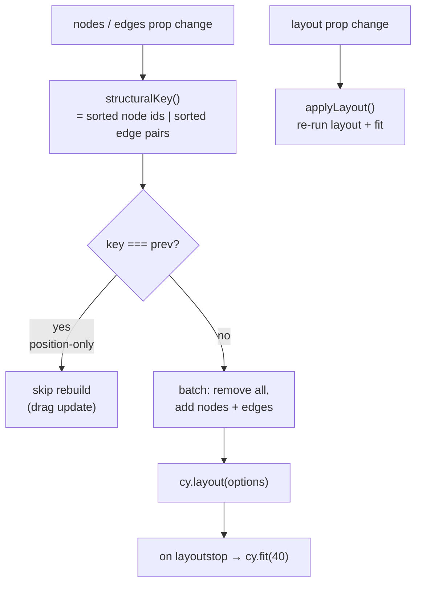

# GraphCanvas

<!-- Component overview for the Cytoscape.js-based Graph Canvas -->
<!-- Explains structure, data flow, and visual appearance -->

Interactive read/edit viewer for node-edge graphs, built on
[Cytoscape.js](https://js.cytoscape.org/). It renders a `GraphDocument` with a
three-panel layout: graph viewport, node table, and property panel. It came from
Pilot, the `portunix-vscode` desktop app, where it shows `*.graph.json` files; see
issue [030](https://github.com/cassandragargoyle/portunix-vscode/blob/main/docs/issues/done/030-graph-canvas-cytoscape-viewer.md) and
ADR [006](https://github.com/cassandragargoyle/portunix-vscode/blob/main/docs/adr/006-react-flow-for-workflow-canvas.md) for the design
rationale (Cytoscape for generic graphs, React Flow for editable workflows).



## Usage

```tsx
import { GraphCanvas } from '@cassandragargoyle/react-components/graph-canvas';

// VS Code webview: the webview API is the port
<GraphCanvas api={acquireVsCodeApi()} />

// Any other host: an object with postMessage(message) receives the canvas events
<GraphCanvas api={{ postMessage: (message) => bridge.send(message) }} />
```

The canvas **receives** its document as `window` `message` events
(`setGraphData`, `selectNode`) and **sends** its events to the `api` port. It
never looks a host API up on its own; a host outside a webview re-dispatches its
own transport onto `window` and passes a port. Optional peers: `cytoscape`,
`cytoscape-dagre`, `ag-grid-community`, `ag-grid-react`.

## 1. Panel Layout

How the component looks on screen today:

```text
┌───────────────────────────────────────────────────────────────────────────────┐
│  GraphToolbar   [⤢] [+] [−] │ Layout: ▼ │ [Find node…]   12 nodes, 18 e│  32px
├──────────────────────────────────────────────────┬────────────────────┤
│                                                  │                    │
│                                                  │  GraphPropertyPanel│
│                GraphViewport                     │                    │
│           (Cytoscape.js canvas)                  │  ● Node: server-01 │
│                                                  │  ───────────────── │
│         ◆ db      ⬡ net      ▢ compute         │  ID     server-01  │
│          │          │          │                 │  Type   compute    │
│          └────►─────┴────►─────┘                 │  ─────────────────  │
│                                                  │  CONNECTIONS       │
│                                                  │  → db-primary      │
├─────────────────────────────────────────────────┤  ← gateway         │
│  ▲ graph-resize-handle (ns-resize, 5px)          │                    │
├─────────────────────────────────────────────────┤   width: 260px     │
│  GraphNodeTable (ag-grid)                        │   fixed             │
│  ID        │ Label      │ Type    │ prop_… │      │                    │
│  server-01 │ Server 01  │ compute │ …      │ 180px│                    │
└─────────────────────────────────────────────────┴────────────────────┘
```

- **Toolbar** — fixed 32px height, top; zoom/fit, layout selector, find, live counts.
- **Viewport** — flexes to fill remaining vertical space; the Cytoscape canvas.
- **Resize handle** — 5px draggable splitter (height clamped 80–500px).
- **Node table** — collapsible ag-grid at the bottom of the center column.
- **Property panel** — fixed 260px right sidebar for the selected node/edge.

## 2. Component Tree



`GraphCanvas` owns all state; child components are controlled (props in,
callbacks out). `GraphViewport` is the only stateful child — it holds the
imperative Cytoscape `Core` instance via a ref.

## 3. Host ↔ Canvas Messaging

The component talks to its host only through messages: the host posts to
`window`, the canvas posts to its `api` port. In a VS Code webview the host is
the extension and the port is the webview API.



Message contracts live in [`types.ts`](./types.ts)
(`ExtensionToWebviewMessage` / `WebviewToExtensionMessage`).

## 4. Selection & Data Flow



Selection is single-source-of-truth in `GraphCanvas.selectedElements`; every
panel derives its view from it via `useMemo`.

## 5. Cytoscape Lifecycle

The viewport separates **structural** changes (nodes/edges added/removed) from
**positional** changes (a node was dragged). Only structural changes trigger a
rebuild + relayout, so dragging one node never reshuffles the whole graph.



Layout algorithms (from [`GraphToolbar`](./GraphToolbar.tsx)): `dagre`
(hierarchical, default), `cose` (force-directed), `breadthfirst`, `circle`,
`grid`. Options mapped in `layoutOptions()` in
[`GraphViewport.tsx`](./GraphViewport.tsx).

## 6. Visual Appearance

A to-scale mockup of the rendered component (VS Code dark theme) lives in
[`GraphCanvas.svg`](./GraphCanvas.svg), the image at the top of this README.
It shows the three panels together with the node shapes and colors per `type`:

| `type` | Shape | Fill | Border |
|--------|-------|------|--------|
| `compute` | round-rectangle | `#4a9eff` | `#3a7ecc` |
| `database` | diamond | `#e6994a` | `#cc8833` |
| `network` | hexagon | `#4ae699` | `#33cc77` |
| _(none)_ | ellipse | `#4a9eff` | `#3a7ecc` |
| _selected_ | grows to 48px | + `#75beff` border, 15% overlay | |

Edges are `#555555` bezier curves with a target triangle arrow;
`type = "dashed"` renders a dashed line, and selection recolors to `#75beff`.

The SVG mirrors `buildStylesheet()` in
[`GraphViewport.tsx`](./GraphViewport.tsx) and the layout rules in
[`GraphCanvas.css`](./GraphCanvas.css). If you change the stylesheet, update
the SVG to match.

## 7. File Map

| File | Role |
|------|------|
| `GraphCanvas.tsx` | Top-level state + three-panel orchestration |
| `GraphViewport.tsx` | Cytoscape.js wrapper (render, zoom, pan, drag, layout) |
| `GraphToolbar.tsx` | Zoom/fit controls, layout selector, find, counts |
| `GraphNodeTable.tsx` | Maps nodes → rows/columns for shared `NodeTablePanel` |
| `GraphPropertyPanel.tsx` | Property + connections view for selection |
| `GraphCanvas.css` | Three-panel layout, VS Code theme variables |
| `types.ts` | `GraphDocument` shape, UI types and the host/canvas message contracts |
| `index.ts` | Public export |
