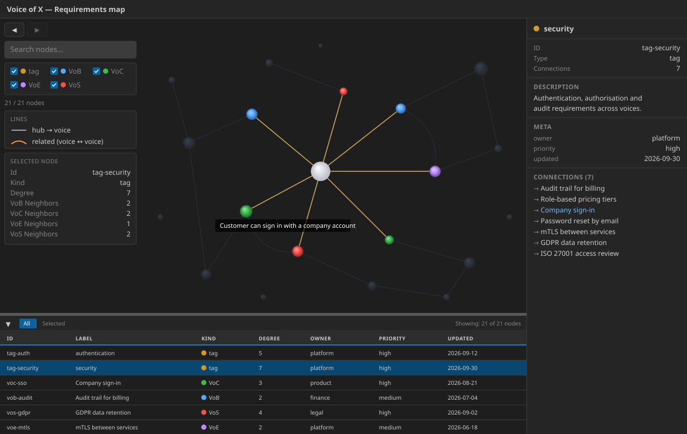

# Prohlížeč GraphLens 3D

Znovupoužitelná komponenta v Reactu a TypeScriptu, která zobrazuje kontrakt
**graphlens** (`meta` + `nodes` + `links`) jako interaktivní 3D silově orientovaný
graf pomocí knihovny
[`3d-force-graph`](https://github.com/vasturiano/3d-force-graph) (Three.js +
d3-force-3d). Je 3D protějškem 2D komponenty `GraphCanvas` postavené na Cytoscape.



Pod 3D zobrazením je tabulka `GraphLensNodeTable` (AG Grid) s nastavitelnou výškou.
Vypisuje uzly právě načteného dokumentu, umí řazení, filtr All/Selected a její výběr
se obousměrně synchronizuje s výběrem ve 3D zobrazení.

## Použití

```tsx
import { GraphLens3D } from '@cassandragargoyle/react-components/graph-lens-3d';

// Pure and prop-driven: the host loads the document and passes it in
<GraphLens3D data={doc} status={loadStatus} />
```

Během načítání je `data` rovno `null`. Nepovinný `status` řídí podrobnou načítací
obrazovku. Volitelné peer závislosti: `3d-force-graph`, `ag-grid-community`,
`ag-grid-react`.

## Zdroj pravdy

Tato komponenta je **jediným zdrojem pravdy** pro GUI pluginu Portunixu `graphlens`
(portunix-plugins #086). Plugin **nesmí** udržovat ručně psaný `static/app.js`;
místo toho si do repozitáře přebírá bundle, který z této komponenty sestavuje
`portunix-vscode`.

## Datový kontrakt

Komponenta zobrazuje dokument `GraphLensDocument` deklarovaný v
[`types.ts`](./types.ts). Pozor na `links` (ne `edges`) a `meta` (ne `metadata`).
Jde záměrně o samostatný typ, odlišný od `GraphDocument` komponenty `GraphCanvas`;
ten nepřetěžujte.

Typ v TS odpovídá **kanonickému schématu GraphView nezávislému na jazyku**
(`Api #011`, `contract/schemas/graph-view.schema.json`): `id`, `type` a `label` jsou
povinné u každého uzlu; `meta` a `version` jsou na úrovni dokumentu nepovinné.
Uložené dokumenty používají příponu `.glens.json`. Typ v TS slaďujte s tímto
schématem a nevymýšlejte paralelní strukturu.

Komponenta dokument proti schématu nevaliduje, ale s chybným dokumentem zůstane
použitelná. Objekt v poli, které se zobrazuje jako text, se ignoruje. Vazba na uzel,
který neexistuje, se vynechá a statistiky ukážou, kolik takových vazeb bylo. Dokument
bez tvaru grafu (pole `nodes` s objekty s `id` a pole `links`) místo grafu ukáže chybu.

## Skupiny uzlů a barvy

Dokument si může definovat vlastní skupiny a barvy bez změny kódu:

```json
{
  "meta": {
    "groups": {
      "language": { "label": "Programming language", "color": "#d29922" },
      "manifest": { "label": "Manifest", "color": "#58a6ff" }
    }
  },
  "nodes": [
    { "id": "language:c", "type": "language", "label": "C", "group": "language" }
  ],
  "links": []
}
```

Skupinou uzlu je první nastavená hodnota v tomto pořadí: `node.group`, `tag` pro
uzly typu tag, `node.voice`, `node.type`. Hodnota, která není neprázdný text, se
bere jako nenastavená. Filtr, statistiky a tabulka uzlů mají pro každou skupinu
jednu položku.

Barvou skupiny je `meta.groups[key].color`, potom vestavěná paleta pro `tag` a hlasy
a nakonec neutrální výchozí barva. Barva, která nemá tvar `#RRGGBB`, se ignoruje a
chybějící definice použije výchozí vzhled, takže dokument bez skupin vypadá stejně
jako dřív. `meta.groups[key].label` nahrazuje klíč všude, kde se skupina zobrazuje;
dlouhý popisek se zkrátí výpustkou a celý text je v jeho tooltipu.

## Způsoby použití v portunix-vscode

| Režim | Vstupní bod | Zdroj dat |
| ----- | ----------- | --------- |
| Samostatný offline bundle | `index.graphlens.tsx` | `fetch('/data.json')` |
| Webview ve VS Code | `index.graphlens.tsx` | `postMessage` (`setGraphData`) |
| Aplikace v Electronu | `index.graphlens.electron.tsx` | IPC most v preloadu (`window.graphLensApi`) |

Vstupní bod `index.graphlens.tsx` volí zdroj dat podle toho, jestli je dostupné
`acquireVsCodeApi()` (webview, nebo samostatný režim). Aplikace v Electronu má
vlastní vstupní bod, který čte `*.glens.json` přes hlavní proces a doručuje ho přes
IPC, stejně jako stávající prohlížeč Canvas.

## Sestavení samostatného bundlu

V `portunix-vscode`:

```bash
make graphlens-bundle
```

Tento příkaz spustí `esbuild.graphlens.mjs` a vytvoří jeden soběstačný bundle IIFE
(`3d-force-graph` a Three.js jsou v něm vložené, CSS se vkládá za běhu) a k němu
`index.html` ve složce `src/vscode-extension/dist/graphlens/`. Nepoužívá se žádné CDN
ani síťová volání třetích stran, jen `GET /data.json` ze stejného původu. Plugin
graphlens si tento výstup přebírá do `plugins/graphlens/src/graphlens/static/`.
