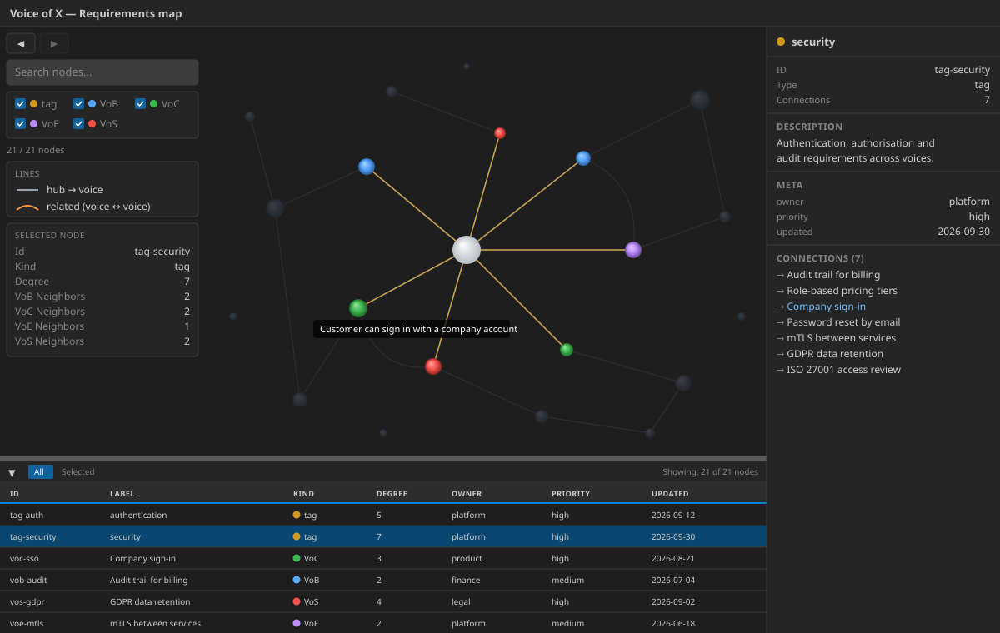

# GraphLens 3D Viewer

Reusable React/TypeScript component that renders the **graphlens** contract
(`meta` + `nodes` + `links`) as an interactive 3D force-directed graph using
[`3d-force-graph`](https://github.com/vasturiano/3d-force-graph) (Three.js +
d3-force-3d). It is the 3D counterpart to the 2D Cytoscape `GraphCanvas`.



Below the 3D viewport, a resizable `GraphLensNodeTable` (AG Grid) lists the
nodes of the currently loaded document — sortable, filterable by All/Selected,
and bidirectionally synced with the viewport selection.

## Usage

```tsx
import { GraphLens3D } from '@cassandragargoyle/react-components/graph-lens-3d';

// Pure and prop-driven: the host loads the document and passes it in
<GraphLens3D data={doc} status={loadStatus} />
```

`data` is `null` while loading; `status` (optional) drives the detailed loading
screen. Optional peers: `3d-force-graph`, `ag-grid-community`, `ag-grid-react`.

## Source of truth

This component is the **single source of truth** for the GUI of the `graphlens`
Portunix plugin (portunix-plugins #086). The plugin must **not** maintain a
hand-written `static/app.js`; it vendors the bundle `portunix-vscode` builds
from this component instead.

## Data contract

The component renders a `GraphLensDocument` declared in [`types.ts`](./types.ts)
— note `links` (not `edges`) and `meta` (not `metadata`). This is intentionally
a separate type from `GraphCanvas`'s `GraphDocument`; do not overload that one.

The TS type mirrors the **canonical, language-independent GraphView schema**
(`Api #011`, `contract/schemas/graph-view.schema.json`): `id`, `type` and
`label` are required on every node; `meta` and `version` are optional at the
document level. Documents at rest use the `.glens.json` filename suffix. Align
the TS type to that schema rather than inventing a parallel shape.

## Consumption modes in portunix-vscode

| Mode | Entry | Data source |
| ---- | ----- | ----------- |
| Standalone offline bundle | `index.graphlens.tsx` | `fetch('/data.json')` |
| VS Code webview | `index.graphlens.tsx` | `postMessage` (`setGraphData`) |
| Electron app | `index.graphlens.electron.tsx` | preload IPC bridge (`window.graphLensApi`) |

The `index.graphlens.tsx` entry gates its data source on whether
`acquireVsCodeApi()` is available (webview vs standalone). The Electron app uses
a dedicated entry that reads `*.glens.json` via the main process and delivers it
over IPC, mirroring the existing Canvas viewer.

## Building the standalone bundle

In `portunix-vscode`:

```bash
make graphlens-bundle
```

This runs `esbuild.graphlens.mjs`, producing a single self-contained IIFE bundle
(`3d-force-graph`/Three.js inlined, CSS injected at runtime) plus `index.html` at
`src/vscode-extension/dist/graphlens/`. No CDN or third-party network calls are
made — only `GET /data.json` from the same origin. The graphlens plugin vendors
this output into `plugins/graphlens/src/graphlens/static/`.
