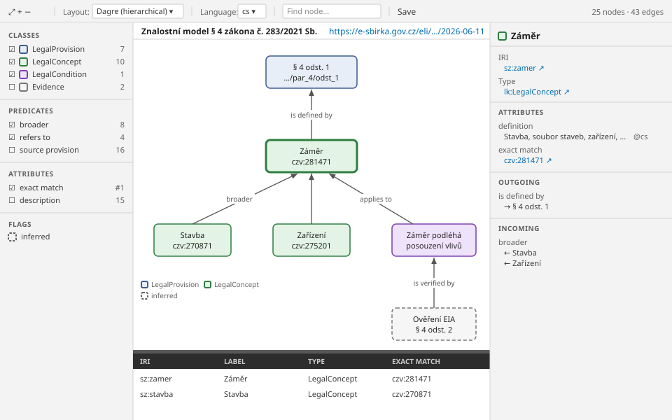

# KnowledgeLens

<!-- Component overview for the Turtle knowledge graph viewer -->
<!-- Explains usage, the projection rules, the saved layout and the message protocol -->

Read-only viewer that shows an RDF document in Turtle syntax (`*.ttl`) as a knowledge graph,
built on [N3.js](https://github.com/rdfjs/N3.js) and [Cytoscape.js](https://js.cytoscape.org/).
It does not draw one node and one edge for every triple: it **projects** the triples into a
readable graph, so labels, descriptions, types and links to external vocabularies become the
text and style of a node instead of more nodes. It came from Pilot, the `portunix-vscode`
desktop app; see issue
[144](https://github.com/cassandragargoyle/portunix-vscode/blob/main/docs/issues/144-knowledgelens-turtle-knowledge-graph-viewer.md).



## Usage

```tsx
import { KnowledgeLens } from '@cassandragargoyle/react-components/knowledge-lens';

// VS Code webview: the webview API is the port; canSave shows the Save button
<KnowledgeLens api={acquireVsCodeApi()} canSave />

// Any other host: an object with postMessage(message) receives the events
<KnowledgeLens api={{ postMessage: (message) => bridge.send(message) }} />
```

The host sends the Turtle **text** and the component parses it, so a host stays thin. Like
[GraphCanvas](../GraphCanvas/README.md), the component **receives** messages as `window`
`message` events and **sends** its events to the `api` port. Optional peers: `n3`,
`cytoscape`, `cytoscape-dagre`, `ag-grid-community`, `ag-grid-react`.

The pure parts are exported too, for a host or a test that needs them without the UI:
`parseTurtle(text)` and `projectGraph(triples, options)`.

## 1. Panel Layout

| Panel | Content |
| ----- | ------- |
| Toolbar | Fit and zoom, layout (`dagre`, `cose`, `breadthfirst`), edge style (orthogonal, straight, curved), title language, find, Save, visible counts |
| Left panel | **Classes** with colour and count (the checkbox hides their nodes); **Predicates** drawn as edges (the checkbox hides their edges); **Attributes** shown as lines in the box; **Flags** |
| Header | Title and source of the dataset or ontology described in the document, else the file name |
| Viewport | Rounded boxes with the title and up to two lines; labelled edges; a legend at the bottom |
| Node table | Shared `NodeTablePanel`: prefixed IRI, label, class, one column per chosen attribute |
| Property panel | Every triple of the selected node grouped by predicate, literals with language and datatype, blank nodes nested, incoming and outgoing edges; a splitter on its left sets its width |

**Edges.** With `dagre` the edges are orthogonal by default: they leave a box vertically, turn
at right angles and enter the next box vertically. Edges into one node turn at the same height
just before it, so they join on one segment and their shared label is shown once. `cose` and
`breadthfirst` draw straight edges by default; the toolbar switches any layout to orthogonal,
straight or curved edges.

**Splitter.** The splitter between the viewport and the property panel changes the panel width
from 200 px up to half of the window: drag it, or focus it and use Left and Right (16 px), Home
and End. A double click restores 260 px.

In the property panel an IRI of a drawn node selects that node; any other IRI posts
`openExternal`, and the host decides whether to open it. Ctrl+F focuses the find field,
Ctrl+A selects every visible node, Ctrl+S saves and Escape clears the selection.

## 2. Projection Rules

`projectGraph(triples, options)` is a pure function; the defaults need no configuration.

| Triple | Projection |
| ------ | ---------- |
| `?s rdf:type ?class` | Style of the node; the first type that is not `owl:Thing`, `owl:NamedIndividual` or `rdfs:Resource` wins |
| `?s ?p "literal"` | Attribute; `skos:prefLabel`, `rdfs:label`, `dcterms:title`, `dc:title`, `foaf:name`, `schema:name` give the title |
| `?s ?p ?o`, `?o` is described in the document | Edge `?s → ?o` labelled with the predicate |
| `?s ?p ?o`, `?o` is not described | Attribute with the shortened IRI, not a node |
| `?s ?p true` (`xsd:boolean`) | Flag: dashed border, one legend entry per predicate |
| `skos:broader` / `skos:narrower`, `dcterms:isPartOf` / `dcterms:hasPart`, `owl:inverseOf` pairs | One edge per pair, drawn in the direction of the first predicate |
| `skos:related`, `skos:exactMatch`, `owl:sameAs` both ways | One edge |
| Subjects typed `rdfs:Class`, `owl:Class`, `rdf:Property`, `owl:*Property` | Not drawn; their label names the class or the edge |
| Subject typed `dcterms:Dataset`, `owl:Ontology`, `void:Dataset`, `dcat:Dataset` | Not drawn; fills the header |
| Blank nodes | Nested attributes of their parent |

- **Edge label** — the English `rdfs:label` of the predicate, else its local name split into
  words (`isSubjectTo` → "is subject to"). The interface is English; only the data keep their
  language
- **Title language** — the language chosen in the toolbar, then English, then an untagged
  literal, then any. The default is the `language` option of the host, else the browser
- **Box lines** — the two attributes most nodes carry with a short value; a node without such a
  value shows its compact IRI (`…/par_4/odst_1`). The left panel changes the choice
- **Colours** — each class gets a colour from a fixed palette in order of first use, a light
  fill with a strong border in a light theme and the reverse in a dark one. A host may pass
  `classStyles` and `flagPredicates`
- **Size** — at most `nodeLimit` nodes (default 2 000) are drawn; above it a warning says how
  many there are. Parsing runs after the first frame, so the loading state is shown at once

## 3. File Comments

N3.js drops `#` comments, so KnowledgeLens reads them from the text with
`extractComments(text)`, which follows the Turtle rules for IRIs and strings: a `#` inside
`<…>`, `"…"` or `"""…"""` is not a comment.

- **Document comment** — the comment lines before the first statement (prefixes and base may
  sit between them). An info icon in the header (**About this file**) opens it below the header in a
  monospace font with its indentation kept. Frame lines such as `=====` are left out
- **Section comments** — a comment block between statements belongs to the subjects that follow
  it, up to the next one. The property panel shows the section of the selected node (its first
  line, the rest folded), and the node table gets a **Section** column
- A comment after a statement on the same line, or between the predicates of a statement, is
  neither; comments never become nodes, edges or attributes

## 4. Saved Layout

With `canSave` the toolbar has a **Save** button (and Ctrl+S). It posts `requestSave` with a
`KnowledgeLensLayout`: the layout algorithm, the edge style, the node positions, the property panel width, whether About this file is open, the hidden classes and
predicates, the chosen box lines and the language. The host stores it next to the Turtle file,
for example `sz-4.ttl.lens.json`, and sends it back with `setTurtleData`. The Turtle file
itself is never changed.

When every node has a saved position the layout algorithm does not run. Nodes that are new
since the save are placed in a grid below the saved ones, so a hand-made arrangement survives
a change of the file.

## 5. Messages

| Direction | Message |
| --------- | ------- |
| Host → component | `{ type: 'setTurtleData', text, fileName, options?, layout? }` |
| Host → component | `{ type: 'selectNode', ids }` |
| Host → component | `{ type: 'layoutSaved' }` — optional confirmation after a save |
| Component → host | `{ type: 'ready' }` |
| Component → host | `{ type: 'selectionChanged', elements }` |
| Component → host | `{ type: 'openExternal', iri }` |
| Component → host | `{ type: 'requestSave', layout }` |

A Turtle syntax error shows the message with the file name, line and column instead of an
empty canvas. When the host sends the corrected text, the graph comes back.

## 6. Demo

`npm run dev` serves the `sz-4.ttl` sample at `http://127.0.0.1:5173/demo/knowledge-lens.html`;
`?light` starts in the light theme, and Save keeps the layout in the browser.
