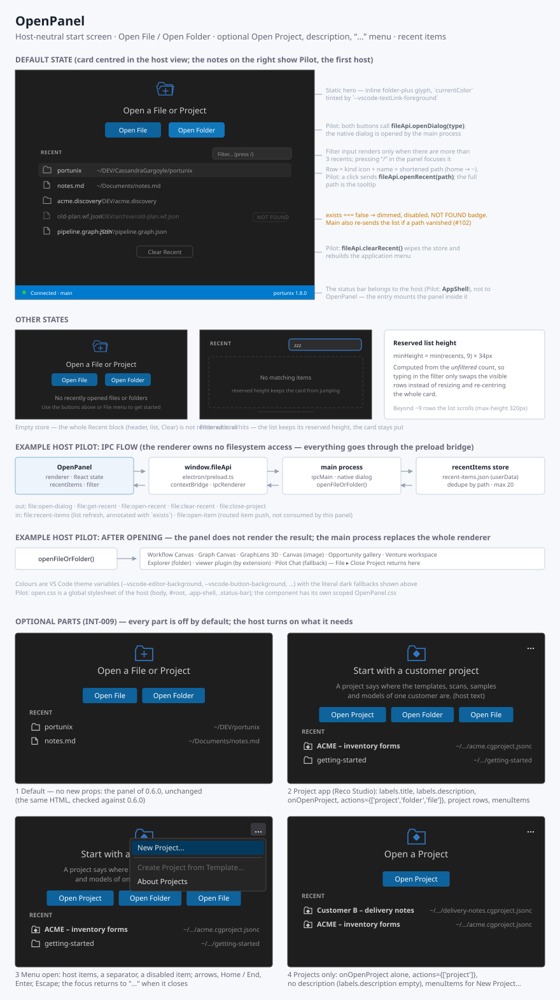

# OpenPanel

**Úvodní obrazovka**: karta uprostřed s tlačítky **Open File** / **Open Folder** a seznamem
**naposledy otevřených** položek s filtrem. Hodí se pro obrazovku „zatím nic není otevřené“
desktopové aplikace nebo webview — panel akci jen spustí a co se stane dál, rozhoduje hostitel.

Panel nezávisí na hostiteli. Nedrží vlastní seznam a nevolá žádné API platformy: naposledy
otevřené položky přicházejí přes `recentItems` a každá akce odchází přes callback. Prvním
hostitelem byl Pilot, desktopová aplikace `portunix-vscode` (#014, chybějící cesty v #102), kde
ho tenký obal napojuje na preload most Electronu; používají ho i další aplikace, například
Reco Studio se svými projekty. Poznámky o Pilotovi ve vizuální referenci ukazují napojení
jednoho hostitele, nejsou součástí komponenty.



## Použití

```tsx
import { OpenPanel, type OpenPanelRecentItem } from '@cassandragargoyle/react-components/open-panel';

function StartScreen({ host }: { host: MyHost }): React.ReactElement {
    const [items, setItems] = useState<OpenPanelRecentItem[] | null>(null);

    useEffect(() => host.loadRecent().then(setItems), [host]);

    return (
        <OpenPanel
            recentItems={items ?? []}
            loading={items === null}
            onOpenFile={() => host.pick('file')}
            onOpenFolder={() => host.pick('folder')}
            onOpenRecent={item => host.open(item.path)}
            onClearRecent={() => host.clearRecent().then(() => setItems([]))}
        />
    );
}
```

Tlačítko bez callbacku se nevykreslí, takže hostitel, který otevírá jen složky, předá jen
`onOpenFolder`.

## Props

| Prop | Typ | Výchozí | Popis |
| ---- | --- | ------- | ----- |
| `recentItems` | `readonly OpenPanelRecentItem[]` | — | Seznam naposledy otevřených položek, nejnovější první; panel ho jen filtruje |
| `onOpenFile` | `() => void` | — | Tlačítko Open File; bez callbacku skryté |
| `onOpenFolder` | `() => void` | — | Tlačítko Open Folder; bez callbacku skryté |
| `onOpenProject` | `() => void` | — | Tlačítko Open Project; bez callbacku skryté |
| `actions` | `readonly OpenPanelAction[]` | `['file', 'folder', 'project']` | Pořadí tlačítek; akce bez svého callbacku se nevykreslí |
| `menuItems` | `readonly OpenPanelMenuItem[]` | — | Položky menu „…“ v pravém horním rohu karty; bez položek skryté |
| `onOpenRecent` | `(item) => void` | — | Klik na existující řádek seznamu |
| `onClearRecent` | `() => void` | — | Tlačítko Clear Recent; bez callbacku skryté |
| `loading` | `boolean` | `false` | Místo prázdného stavu ukáže *Loading recent items...* |
| `filterThreshold` | `number` | `3` | Pole filtru se objeví nad tímto počtem položek |
| `formatPath` | `(path) => string` | `shortenHomePath` | Zobrazená podoba cesty; tooltip ukazuje celou cestu |
| `labels` | `Partial<OpenPanelLabels>` | anglicky | Přepsání libovolného viditelného textu |
| `icon` | `ReactNode` | složka s plusem | Ikona nad nadpisem; `null` ji skryje |
| `className`, `style` | | — | Použijí se na kořenový prvek `.open-panel` |

Položka seznamu:

```ts
interface OpenPanelRecentItem {
    type: 'file' | 'folder' | 'project';   // drives the row icon
    path: string;              // key, tooltip and filter haystack
    name: string;              // bold display name
    lastOpened?: string;       // carried for the host, not rendered
    exists?: boolean;          // false → dimmed, disabled, "Not found"
}
```

Exportované jsou i `DEFAULT_OPEN_PANEL_LABELS`, `DEFAULT_OPEN_PANEL_ACTIONS` a
`shortenHomePath`, pro hostitele, který chce výchozí hodnoty rozšířit, ne nahradit.

## Projekty a menu „…“

Aplikace, která pracuje s projekty, si zapne části, které potřebuje; **každá část je ve
výchozím stavu vypnutá**, takže hostitel, který žádnou nepředá, vykreslí panel jako dřív
(INT-009). Panel o projektových souborech nic neví: co je projekt, rozhoduje hostitel a text
píše on.

```tsx
<OpenPanel
    recentItems={items}                       // items of type 'project' get the project icon
    onOpenProject={() => host.pick('project')}
    onOpenFolder={() => host.pick('folder')}
    onOpenFile={() => host.pick('file')}
    actions={['project', 'folder', 'file']}   // the project button first
    menuItems={[
        { id: 'new-project', label: 'New Project…', onSelect: () => host.newProject() },
        { separator: true },
        { id: 'from-template', label: 'Create Project from Template…', onSelect: () => host.fromTemplate(), disabled: true },
    ]}
    labels={{
        title: 'Start with a customer project',
        description: 'A project says where the templates, scans, samples and models of one customer are.',
    }}
/>
```

| Část | Zapne ji | Poznámka |
| ---- | -------- | -------- |
| Tlačítko Open Project | `onOpenProject`; text `labels.openProject` | Bez tří teček, stejně jako ostatní tlačítka |
| Pořadí tlačítek | `actions` | Akce uvedená dvakrát se vykreslí jednou |
| Popis pod nadpisem | `labels.description` | Prázdný popis nevykreslí nic |
| Menu „…“ | `menuItems` | Přístupné jméno `labels.more`; menu jen z oddělovačů se nevykreslí |
| Řádky projektů | položky s `type: 'project'` | Ikona složky s kosočtvercem; jméno je jméno projektu od hostitele |

Menu se chová jako menu button podle WAI-ARIA: klik, Enter, mezerník nebo šipka dolů ho otevře
na první aktivní položce (šipka nahoru na poslední), šipky nahoru a dolů, Home a End se
pohybují po aktivních položkách, Enter nebo mezerník vybere a Escape, Tab nebo klik mimo menu
ho zavře. Zavření klávesnicí nebo výběrem vrátí fokus na tlačítko „…“. Položky menu smějí
končit `…`, když otevírají dialog — tak to v menu bývá zvykem.

## Chování

- **Filtr** — hledá podřetězec v `name` **i** `path` bez ohledu na velikost písmen. Klávesa
  `/` kdekoli v panelu (mimo vstupní pole) přesune fokus do filtru. Bez shody se ukáže
  *No matching items*.
- **Stálá výška** — seznam si rezervuje `min(položky, 9) × 34px` podle počtu **nefiltrovaných**
  položek, takže psaní do filtru kartu nezvětšuje ani nepřecentruje. Nad 320px se posouvá.
- **Chybějící cesty** — položka s `exists === false` je ztlumená a neaktivní, má štítek
  *Not found* a tooltip `"<path> (not found)"`; klik nic neudělá.
- **Zkracování cest** — `shortenHomePath` nahradí úvodní `/home/<user>`, `/Users/<user>` nebo
  `C:\Users\<user>` znakem `~`.
- **Prázdný stav a načítání** — bez položek panel ukáže prázdný stav, nebo řádek načítání,
  dokud je `loading` pravda, v oblasti `role="status"`.

## Styly

Stylopis se vloží jednou při prvním použití a platí jen pro třídy `.open-panel-*`; nemění
`body` ani rozvržení stránky. Kořen vyplní výšku rodiče (`height: 100%`), takže rodič musí mít
výšku. Barvy čtou proměnné motivu VS Code (`--vscode-button-background`,
`--vscode-textLink-foreground`, `--vscode-input-*`, `--vscode-descriptionForeground`,
`--vscode-list-hoverBackground`, `--vscode-menu-*`, …) s náhradními hodnotami tmavého motivu a
každý interaktivní prvek má obrys `:focus-visible`.

## Soubory

- `OpenPanel.tsx` — komponenta, její props a výchozí texty
- `OpenPanel.css` — stylopis omezený na komponentu
- `OpenPanel.test.tsx` — unit testy
- `OpenPanel.svg` — vizuální reference (obrázek tohoto README), včetně čtyř variant volitelných
  částí
- `README.cs.md` — tento český překlad
- `index.ts` — veřejné exporty

---

**Vytvořeno**: 2026-08-16
**Naposledy upraveno**: 2026-11-17
