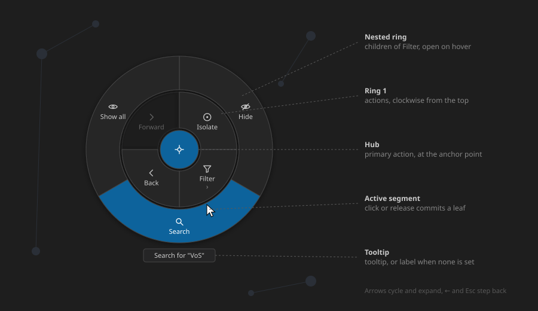

# RadialMenu

<!-- Component overview for the radial (pie) action menu -->
<!-- Explains the options contract, the hook, interaction and styling -->

A **radial action menu**: a primary action in the centre hub, the other actions in a ring of
segments around it, and nested rings that open outward for actions with children. It opens
at a point (a right-click or a long-press on a diagram) and is driven by the pointer or the
keyboard; the first host is the GraphLens 3D node menu.

The menu is host-neutral: it knows nothing of the diagram under it. The host passes the
actions and the anchor point and gets the choice back through each action's `onSelect`.



## Usage

```tsx
import { useRadialMenu, type RadialMenuAction } from '@cassandragargoyle/react-components/radial-menu';

function Diagram(): React.ReactElement {
    const radial = useRadialMenu();

    const openMenu = (e: React.MouseEvent, nodeId: string) => {
        e.preventDefault();
        const actions: RadialMenuAction[] = [
            { id: 'isolate', icon: icons.isolate, label: 'Isolate', onSelect: () => isolate(nodeId) },
            {
                id: 'filter',
                icon: icons.filter,
                label: 'Filter',
                children: [
                    { id: 'hide', icon: icons.hide, label: 'Hide', onSelect: () => hide(nodeId) },
                    { id: 'show-all', icon: icons.showAll, label: 'Show all', onSelect: showAll },
                ],
            },
            { id: 'back', icon: icons.back, label: 'Back', disabled: !canBack, onSelect: back },
        ];
        radial.open({
            position: { x: e.clientX, y: e.clientY },
            hub: { id: 'focus', icon: icons.focus, label: 'Focus', onSelect: () => focus(nodeId) },
            actions,
        });
    };

    return (
        <>
            <svg onContextMenu={(e) => openMenu(e, hoveredId)}>{/* the diagram */}</svg>
            {radial.menu}
        </>
    );
}
```

`radial.menu` renders through a portal into `document.body`, so where it sits in the tree
does not matter. `RadialMenu` can also be rendered directly with `options` and `onClose`
when the host keeps the open state itself.

## API

`useRadialMenu()` returns `UseRadialMenu`:

| Member | Type | Description |
| ------ | ---- | ----------- |
| `open` | `(options: RadialMenuOptions) => void` | Opens the menu, or re-anchors an open one |
| `close` | `() => void` | Closes it without invoking any action |
| `isOpen` | `boolean` | Whether the menu is open |
| `menu` | `ReactElement \| null` | The element to place in the host tree |

`RadialMenuOptions`:

| Field | Type | Default | Description |
| ----- | ---- | ------- | ----------- |
| `hub` | `RadialMenuAction` | — | Primary action in the centre hub; its icon is shown, not its label |
| `actions` | `RadialMenuAction[]` | — | Ring-1 segments, clockwise from the top |
| `position` | `{ x, y }` | — | Anchor in viewport (client) coordinates |
| `radius` | `number` | `96` | Outer radius of ring 1, in pixels |
| `ringGap` | `number` | `60` | Width of each nested ring, in pixels |

`RadialMenuAction`:

| Field | Type | Description |
| ----- | ---- | ----------- |
| `id` | `string` | Unique among its siblings |
| `icon` | `ReactNode` | Monochrome 16px stroke icon; it inherits `currentColor` |
| `label` | `string` | Short text on the segment |
| `tooltip` | `string` | Longer text shown below the menu; falls back to `label` |
| `disabled` | `boolean` | Dimmed and cannot be committed |
| `onSelect` | `() => void` | Invoked when a leaf is committed |
| `children` | `RadialMenuAction[]` | Opens an outer ring instead of committing |

## Behavior

- **Hover selects** — the segment under the pointer is highlighted and its tooltip shows
  below the menu. Hovering a segment with children opens its ring around the whole menu,
  split evenly; a `›` marks such segments.
- **Commit** — a mouse click, or the release of a touch or pen long-press, over a leaf
  calls its `onSelect` and closes the menu. A segment with children never commits, and a
  disabled one does nothing.
- **Cancel** — a click outside every ring, `Escape` on ring 1, or a scroll, resize or
  window blur closes the menu without an action.
- **Keyboard** — the overlay takes focus on open (`role="menu"`). `↓`/`↑` cycle the
  current ring, `→` or `Enter` opens a segment's children, `←` or `Escape` steps back a
  ring, and `Enter` or `Space` commits a leaf.

## Styling

The stylesheet is injected once on first use and scoped to `.radial-menu-*` classes. The
overlay is a transparent, fixed full-viewport layer at `z-index: 10000`. Colours read the VS
Code theme variables (`--vscode-menu-background`, `--vscode-menu-selectionBackground`,
`--vscode-button-background`, `--vscode-menu-border`, `--vscode-editorHoverWidget-*`, …)
with dark-theme fallbacks.

## Files

- `RadialMenu.tsx` — the component: geometry, hit-testing, nested rings, keyboard
- `useRadialMenu.ts` — the hook that opens and closes a single menu
- `types.ts` — `RadialMenuAction`, `RadialMenuOptions`, `RadialMenuActive`
- `RadialMenu.css` — scoped stylesheet
- `RadialMenu.svg` — visual reference (this README's image)
- `index.ts` — public exports
